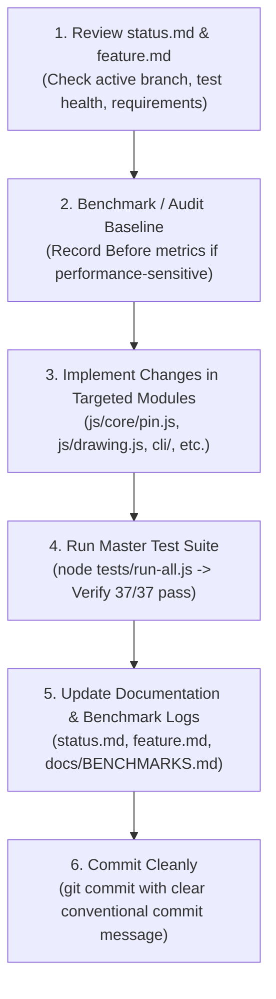

# BoardCraft (Investigative Board) - Project Instructions & Developer Guide

> **For Humans, Autonomous Agents, and Claude**: This is the primary instruction file for working on this repository. It defines architectural principles, repository structures, cross-referenced documentation, coding standards, and operational workflows.

---

## 1. Project Overview & Ecosystem Alignment

**Investigative Board (BoardCraft)** is a high-performance, local-first infinite canvas spatial workbench designed following the design principles of the [ArtCraft](https://getartcraft.com/apps) desktop suite.

* **Repository Working Branch:** `file_functions`
* **Test Suite Health:** **37 passed, 0 failed out of 37 suites** (`node tests/run-all.js`)
* **Zero Runtime Dependencies:** No external npm runtime dependencies. Pure local execution relying strictly on HTML5 Canvas / Web APIs and native Node.js built-in modules (`fs`, `path`, `http`, `crypto`, `readline`).
* **Frame & Performance Budget:** $\le 16.6\text{ ms}$ total frame time (locked 60 FPS); connection jump detection $\le 2.0\text{ ms}$; pin instantiation $\le 50\text{ µs}$.

---

## 2. Master Documentation Map

Always reference and maintain these core documents when developing or evaluating features:

| Document | Purpose & Scope |
| :--- | :--- |
| **[`status.md`](file:///Users/health/Sites/investigative-board/status.md)** | **Current Project Health & Verification Tracker**: Test suite pass matrix (37/37), active branch, recent commit logs, and bug resolution status (`BUG-001` through `BUG-017`). |
| **[`feature.md`](file:///Users/health/Sites/investigative-board/feature.md)** | **Complete Feature Catalog**: Detailed specifications for Infinite Canvas, `Pin` class, Smart Line Jumps (Bridge Arcs), Stencil Palette, 45° Radial Branching, Themes, and Layout Dock. |
| **[`agent_instruction.md`](file:///Users/health/Sites/investigative-board/agent_instruction.md)** | **Agent Automation Manual**: Full reference for all **22 Model Context Protocol (MCP)** tools, stdio JSON-RPC transport, CLI commands, and REST/SSE API endpoints. |
| **[`docs/ROADMAP.md`](file:///Users/health/Sites/investigative-board/docs/ROADMAP.md)** | **Strategic Roadmap**: Phased milestones (Phase 1: Core Engine ✅, Phase 2: Desktop Shell & `.craftboard`, Phase 3: Rich Media & Data-Flow, Phase 4: Multi-Agent Co-Canvas). |
| **[`docs/ARCHITECTURE.md`](file:///Users/health/Sites/investigative-board/docs/ARCHITECTURE.md)** | **System Architecture**: Subsystem component breakdown, coordinate transformation math (screen-to-world / world-to-screen), and rendering pipelines. |
| **[`docs/BENCHMARKS.md`](file:///Users/health/Sites/investigative-board/docs/BENCHMARKS.md)** | **Performance Audits & Before/Try/Try/After Logs**: Systematic performance logs (Log 001 Line Jumps, Log 002 Stencil Spawning, Log 003 MCP Tools, Log 004 Pin Class & Inset Media). |
| **[`docs/PROGRESS.md`](file:///Users/health/Sites/investigative-board/docs/PROGRESS.md)** | **Historical Bug Tracker & Resolution Log**: Detailed root cause analysis for all resolved bugs and architectural milestones. |

---

## 3. Directory & File Organization

```
investigative-board/
├── index.html                   # Main application web shell & DOM layout
├── package.json                 # Project configuration (test runners, scripts)
├── status.md                    # Current health, test matrix, and active status
├── feature.md                   # Full application feature catalog
├── agent_instruction.md         # MCP, CLI, and REST automation manual
├── CLAUDE.md                    # Master developer & AI agent instructions (this file)
│
├── cli/                         # ArtCraft Agent Automation Suite
│   ├── index.js                 # Standalone CLI binary (list, create, search, serve, mcp)
│   ├── mcp-server.js            # Model Context Protocol stdio JSON-RPC 2.0 server (22 tools)
│   ├── server.js                # Local HTTP static server + Live SSE sync bridge (/api/events)
│   └── storage.js               # Multi-board file storage engine & JSON persistence
│
├── data/                        # Persistent Local Storage
│   └── boards/                  # Board documents (<id>.json), index.json, stencils.json, themes.json
│
├── css/                         # Application Styling
│   ├── board-styles.css         # Canvas, stencil dock, modal, and theme styling
│   └── toolbar.css              # Top menu, toolbar, and layout dock styles
│
├── js/                          # Frontend Architecture
│   ├── core/                    # Core Subsystems
│   │   ├── app.js               # Application coordinator, connection rendering, line jumps
│   │   ├── pin.js               # Canonical Pin class, archetype factories, bounds, inset media
│   │   ├── schema.js            # Board schemas, 8-slot theme engine (c1..c8), validation
│   │   ├── state.js             # Application state, selection management, history undo/redo
│   │   ├── boardManager.js      # Multi-board CRUD and active board switcher
│   │   ├── branchManager.js     # Hold-to-branch, 45° radial angular snap, opposite symmetry
│   │   ├── dragManager.js       # Smooth pin and marquee drag operations
│   │   ├── layoutEngine.js      # Master 40px grid snapping & aspect alignment algorithms
│   │   ├── syncBridge.js        # Live SSE event receiver for real-time background agent updates
│   │   ├── constants.js         # Global constants, colors, and defaults
│   │   └── utils.js             # General helper utilities
│   │
│   ├── domain/                  # Domain Models
│   │   ├── nodeTypes.js         # Entity node type definitions
│   │   ├── connections.js       # Connection data structures
│   │   └── cards.js             # Card and dossier structures
│   │
│   ├── events/                  # Event Handlers & Input Routing
│   │   └── eventHandlers.js     # Canvas click/drag/zoom, hotkeys, tool dispatch, stencil drop
│   │
│   ├── ui/                      # User Interface Components
│   │   ├── stencilDock.js       # Investigative Stencil Dock & clue presets (Shift+S)
│   │   ├── modal.js             # Pin, Connection, and Board edit modals (Image tab with inset layer)
│   │   ├── toolbar.js           # Top toolbar, tools, and actions
│   │   ├── tray.js              # Bottom clue tray
│   │   ├── systemMenu.js        # File menu, theme dropdown, layout actions
│   │   └── boardPicker.js       # Multi-board visual switcher modal
│   │
│   ├── drawing.js               # Canvas rendering engine, shapes, line bridge arcs, badges
│   ├── pins.js                  # Selection algorithms and connected component analysis
│   ├── text.js                  # Text element rendering and inline editing
│   ├── themes.js                # Legacy theme bridge
│   └── utilities.js             # Canvas geometry, roundRect, and math helpers
│
├── docs/                        # Project Specifications & Historical Logs
│   ├── ARCHITECTURE.md          # Full architectural design document
│   ├── BENCHMARKS.md            # Empirical performance logs (Before / Try / Try / After)
│   ├── PROGRESS.md              # Historical bug tracking & detailed fixes
│   ├── ROADMAP.md               # 5-Phase strategic roadmap
│   └── API_AND_AGENT_SPEC.md    # Developer API specification
│
└── tests/                       # Automated Regression Test Suite
    ├── run-all.js               # Master test runner (executes all 37 test suites)
    ├── test-pin-class.js        # Unit tests for Pin class, archetypes, bounds & inset media
    ├── test-artcraft-agent-api  # Agent MCP suite, AI stencils, themes, shapes & REST tests
    ├── test-mcp-server.js       # MCP JSON-RPC protocol compliance test
    ├── test-stencil-palette.js  # Stencil palette lifecycle and stamping tests
    ├── test-connection-jumps... # Line jump bridge arcs and label tests
    └── ...                      # 31 additional unit and regression test suites
```

---

## 4. Fundamental Engineering Guidelines

When working in this codebase, humans, agents, and Claude must adhere to these five rules:

### Rule 1: Zero External Runtime npm Dependencies
All application code in `js/`, `cli/`, and `css/` must execute using native web APIs (Canvas, DOM, SSE) and Node.js built-ins. Do not run `npm install` for runtime libraries.

### Rule 2: Preserve Documentation Integrity
Never overwrite or strip existing explanatory comments, JSDoc annotations, or test assertions unrelated to your task. Keep documentation accurate and synchronized.

### Rule 3: Validate Against the Master Test Suite
Before completing any task, run the master test suite:
```bash
node tests/run-all.js
```
**Every one of the 37+ test suites must pass.** If a change alters behavior, update or add test coverage to maintain 100% pass rates.

### Rule 4: Maintain Before / Try / Try / After Performance Logs
Whenever auditing, optimizing, or refactoring rendering, hit-testing, or data structures:
1. Benchmark the baseline (**Before**).
2. Measure iterations (**Try 1**, **Try 2**).
3. Document empirical metrics in [`docs/BENCHMARKS.md`](file:///Users/health/Sites/investigative-board/docs/BENCHMARKS.md).

### Rule 5: Terminal Sandbox Awareness
Run file inspections, edits, and automated test runners inside the standard secure sandbox. Only elevate commands (`BypassSandbox: true`) when performing `.git/` commits or operations requiring manual approval.

---

## 5. Standard Development Workflow



---

## 6. Key Subsystem Reference Notes

* **Pin Model ([`js/core/pin.js`](file:///Users/health/Sites/investigative-board/js/core/pin.js))**: Canonical domain object. Always use `pin.label` (with `pin.title` mirrored), `pin.customFields` (with `pin.metadata` mirrored), and `pin.image.layer = 'inset' | 'behind'`.
* **Stencil Dock ([`js/ui/stencilDock.js`](file:///Users/health/Sites/investigative-board/js/ui/stencilDock.js))**: Accessible via <kbd>Shift</kbd>+<kbd>S</kbd>. Stencils spawn pins aligned to the 40px master grid.
* **Smart Line Jumps ([`js/core/app.js`](file:///Users/health/Sites/investigative-board/js/core/app.js))**: Crossing connection lines render $R=8\text{px}$ bridge arcs filtered with precomputed AABB scalar checks.
* **Theme Roles ([`js/core/schema.js`](file:///Users/health/Sites/investigative-board/js/core/schema.js))**: Color slots `c1` through `c8` define roles (Suspect, Lead, Corroborated, Scene, Syndicate, Hazard, Forensic, Intel) that update harmoniously across themes.
