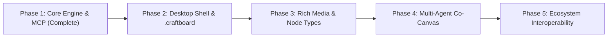

# BoardCraft Strategic Roadmap & ArtCraft Ecosystem Alignment

This document outlines the strategic transformation of **Investigative Board** into **BoardCraft** (an ArtCraft-aligned desktop creative application, following the design principles of [getartcraft.com/apps](https://getartcraft.com/apps)).

---

## 1. Vision & Ecosystem Placement

The **ArtCraft** suite includes specialized creative tools built for local-first execution, clean aesthetic simplicity, offline privacy, and native agent automation (via CLI and MCP). Currently, ArtCraft includes apps for prose, audio, prompts, and design, but lacks a dedicated **spatial investigation and node-link canvas application**.

```
                           ┌────────────────────────┐
                           │     ArtCraft Suite     │
                           └───────────┬────────────┘
         ┌───────────────────┬─────────┴─────────┬───────────────────┐
         ▼                   ▼                   ▼                   ▼
    StoryCraft          AudioCraft          PromptCraft          BoardCraft
(Prose & Narrative)  (Sound & Voice)    (LLM Interaction)    (Spatial Canvas)
                                                                 ▲
                                                      [THIS PROJECT]
```

**BoardCraft** fills this vacancy as a high-performance, infinite-canvas spatial workbench for detectives, writers, researchers, and autonomous AI agents.

---

## 2. Guiding Architectural Principles

1. **Local-First & Offline-Default**: All files live on the user's filesystem in open formats (`.craftboard` bundles containing JSON + media assets).
2. **First-Class Agent Automation**: Any action a human can perform with a mouse or keyboard must be executable by an AI agent through the CLI and Model Context Protocol (MCP).
3. **Sub-millisecond Canvas Latency**: HTML5 Canvas / WebGL rendering with viewport culling, zero layout thrashing, and support for thousands of pins and connections at 60+ FPS.
4. **ArtCraft Aesthetic**: Minimalist, hyper-focused dark and light studio palettes, keyboard-first ergonomics, and distraction-free UI chroming.

---

## 3. Phased Milestones



### Phase 1: Core Engine & MCP Standard (Status: Completed ✅)
- [x] Fix merge issues and stabilize single-board & multi-board architectures.
- [x] Viewport culling for infinite canvas rendering.
- [x] Theme system with dark, light, sepia, nord, and midnight modes.
- [x] Standalone Node.js CLI (`boardcraft-cli`) with zero external dependencies.
- [x] Model Context Protocol (MCP) JSON-RPC 2.0 server supporting 13 tools and resource inspection.
- [x] Server-Sent Events (SSE) synchronization bridge between CLI and browser.
- [x] 25-suite automated regression test runner.

---

### Phase 2: Desktop Shell & Native `.craftboard` Format (Target: Q2)
Transform the web application into an ArtCraft-standard desktop binary.
- **Tauri v2 + Rust Architecture**:
  - Package frontend into a native macOS / Windows / Linux lightweight executable.
  - Rust backend providing direct filesystem I/O, secure token management, and native file associations.
- **`.craftboard` Document Bundle**:
  - Standard directory-bundle or zip container format:
    ```
    my-investigation.craftboard/
    ├── board.json          # Pin coordinates, text, connections, theme metadata
    ├── manifest.json       # App version, author, timestamp, checksums
    ├── thumbnails/         # 256x256 and full-resolution canvas previews
    └── assets/             # Local images, audio clips, and documents
    ```
- **Directory Root Boundaries**:
  - Implement ArtCraft's `--automation-read-root` and `--automation-write-root` sandboxing flags for agent security.

---

### Phase 3: Rich Media & Specialized Pin Types (Target: Q3)
Expand beyond simple text pins and pinned cards into multi-modal canvas nodes.
- **Media Pins**:
  - Local image cards with auto-thumbnails and aspect ratio preservation.
  - Audio evidence pins with embedded micro-waveform player.
  - PDF document snippets with page flip controls.
- **Connection Mechanics**:
  - String / thread tension styles: taut red string, sagging yarn, dashed lead line, directional arrows.
  - Line labels and evidence confidence indicators (e.g. *Confirmed*, *Hypothesis*, *Contradiction*).
- **Groupings & Evidence Clusters**:
  - Bounding areas / envelopes (e.g., suspect groupings, timeline blocks, geographic regions).
  - Spatial auto-pack and force-directed auto-layout algorithms for messy boards.

---

### Phase 4: Multi-Agent Co-Investigation & Control Channel (Target: Q4)
Enable autonomous agents to collaborate live on the canvas alongside human users.
- **ArtCraft Control Socket**:
  - Localhost TCP socket (`127.0.0.1:PORT`) using newline-delimited JSON (NDJSON).
  - Token-file authentication (`~/.boardcraft/.control.token`) matching ArtCraft's native CLI bridge.
- **Agent Presence & Telemetry**:
  - Ghost cursors indicating where autonomous agents are actively reading or editing.
  - Activity log sidebar: stream of tool actions executed by local agents (e.g. `agent added 4 pins linked to 'Suspect A'`).
- **Interactive Prompts**:
  - Built-in "Agent Assist" palette (`Cmd+K`): "Connect pins related to financial fraud", "Reorganize chronologically", "Highlight contradictions".

---

### Phase 5: Ecosystem Interoperability & Publishing (Target: Future)
- **Format Bridges**:
  - Two-way import/export for **Obsidian Canvas** (`.canvas`), **Miro** (`.rtb`), and **Milanote**.
  - High-resolution vector export (SVG, multi-page PDF presentation).
- **Presentation Mode**:
  - Camera waypoint sequence: step-by-step camera panning through evidence paths for storytelling or courtroom-style briefings.
- **ArtCraft Unified Workspace**:
  - Cross-launching between ArtCraft apps (e.g. double-click a character pin in BoardCraft to open their bio in StoryCraft).
